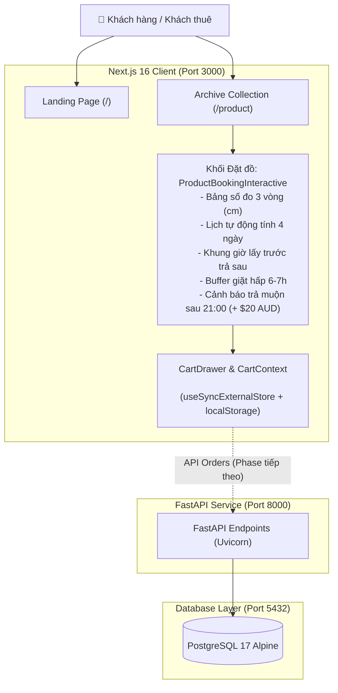

# STOE — LUA Studio Áo Dài Rental Platform

Nền tảng thương mại điện tử chuyên biệt cho thuê trang phục áo dài truyền thống & tơ lụa độc bản cao cấp của **LUA Studio** (Melbourne, Úc). 

Hệ thống số hóa toàn diện quy trình vận hành studio: khách hàng có thể đối chiếu mã áo trực tiếp, tra cứu thông số 3 vòng chuẩn xác, tự động tính ngày trả theo gói thuê (1 ngày, 4 ngày, 8 ngày), đặt khung giờ lấy/trả hợp lệ, tự động tính phụ phí trả sau 21h và ngăn chặn xung đột trùng lịch kèm thời gian đệm vệ sinh, giặt hấp bảo vệ tơ lụa 6–7 tiếng.

---

## 1. Sơ đồ Cấu trúc Dự án (Folder Structure)

```text
seeling-system/ (stoe/)
├── .agents/                    # Bộ quy tắc (Rules) & hướng dẫn vận hành của AI Agent
├── backend/                    # Dịch vụ Backend API
│   ├── main.py                 # FastAPI Application entry point (Uvicorn)
│   ├── pyproject.toml          # Quản lý dependencies (FastAPI, Uvicorn, v.v.)
│   └── Dockerfile              # Docker container cho backend service
├── frontend/                   # Ứng dụng Web Client (Next.js 16 + React 19 + Tailwind CSS)
│   ├── docs/                   # Tài liệu kỹ thuật frontend (Roadmap, Tutorials, Design System)
│   │   ├── roadmap/            # Lộ trình phát triển 6 Phase (ROADMAP.md, Phase 1 -> 5)
│   │   ├── booking-tutorial.md # Hướng dẫn chi tiết nghiệp vụ booking cho newbie
│   │   └── navigation-tutorial.md # Hướng dẫn hệ thống Navigation & Mobile Drawer
│   ├── public/images/          # Tài nguyên hình ảnh áo dài tơ tằm độ phân giải cao
│   └── src/
│       ├── app/                # Next.js App Router (PPR): Trang chủ (/), Bộ sưu tập (/product), Chi tiết (/product/[slug])
│       ├── components/
│       │   ├── blocks/         # Page sections: Hero, ProductBookingInteractive, CollectionView...
│       │   ├── cart/           # CartDrawer (Slide-over bag trượt từ bên phải)
│       │   ├── layout/         # Header (Track URL nhẹ nhàng), Footer, MobileMenu
│       │   └── ui/             # Atomic components: Button, Chip, Input, Accordion
│       ├── context/            # CartContext (Quản lý giỏ hàng qua useSyncExternalStore)
│       ├── data/               # Mock data: Danh mục áo dài (products.ts) & Lịch tồn kho (bookings.ts)
│       ├── lib/                # Hằng số định hướng (constants.ts) và tiện ích (utils.ts)
│       └── types/              # TypeScript definitions: Product, BookingDetails, ExistingBooking
├── docs/                       # Tài liệu nghiệp vụ & kiến trúc hệ thống gốc
│   ├── BUSINESS_REQUIREMENT.md # Kim chỉ nam nghiệp vụ: Buffer 6-7h, Trả sau 21h, Đối chiếu số đo
│   └── knowledge/              # Báo cáo kỹ thuật, kiểm thử và hướng dẫn vận hành
├── logs/                       # Log chạy tiến trình local (frontend.log, backend.log)
├── compose.yml                 # Docker Compose điều phối Fullstack: Frontend, Backend, PostgreSQL 17
├── start-app.sh                # Script Bash khởi động đồng thời cả Frontend và Backend chạy song song
└── README.md                   # Tài liệu tổng quan dự án (File này)
```

---

## 2. Sơ đồ Luồng Vận hành (System Architecture)



---

## 3. Các Tính Năng Nghiệp vụ Nổi bật

1. **Đối chiếu Trực tiếp Mã áo & Số đo 3 vòng**:
   - Hiển thị rõ mã độc bản (ví dụ: `AD-12`), hình ảnh chân dung đối chiếu, thông số người mẫu `1m68 Size S`.
   - Bảng tra cứu số đo chi tiết (ngực, eo, mông, chiều dài cm) giúp xóa bỏ hoàn toàn nhu cầu tư vấn thủ công qua Google Drive.
2. **Gói thuê & Tự động tính ngày hoàn trả**:
   - Gói 1 ngày (24h sự kiện), Gói 4 ngày (tiêu chuẩn cưới/tiệc), Gói 8 ngày (mở rộng du lịch).
   - Tự động cộng số ngày và đánh dấu dải ngày trả đồ trên lịch.
3. **Khung giờ Lấy đồ & Trả đồ thông minh**:
   - Giờ lấy bắt buộc phải diễn ra trước giờ trả.
   - Studio ngưng đón khách sau **21:00**. Nếu khách chọn trả đồ sau 21:00 (`09:30 PM`, `10:00 PM`, `11:00 PM`), hệ thống bật cảnh báo màu hổ phách và tự động tính phụ phí ngoài giờ **+ $20 AUD (150.000₫)** để nhân viên follow-up.
4. **Chặn Trùng lịch & Buffer Khử khuẩn 6–7 tiếng**:
   - Khi Khách A đã book đồ (ví dụ: 8:00 AM – 8:00 PM ngày 01/01/2027), Khách B không thể book khung giờ này.
   - Hệ thống tự động khóa thêm khoảng đệm **6–7 tiếng** sau khi trả đồ (đến 03:00 AM 02/01/2027) để studio thực hiện giặt hấp sinh học và khử khuẩn tia cực tím UV.
5. **Giỏ hàng Editorial & Đồng bộ State**:
   - Slide-over Drawer từ cạnh phải màn hình hiển thị toàn bộ chi tiết đặt thuê, phí ship bưu điện và phụ phí ngoài giờ.
   - Tích hợp `useSyncExternalStore` của React 19 để đồng bộ an toàn với `localStorage`, loại bỏ hoàn toàn lỗi Hydration Mismatch.

---

## 4. Hướng dẫn Cài đặt & Khởi chạy (Quick Start)

### Chuẩn bị môi trường
```bash
cp .env.example .env.local
```

### Cách 1: Khởi chạy nhanh bằng Script (Khuyên dùng khi dev local)
```bash
chmod +x start-app.sh
./start-app.sh
```
* Frontend chạy tại: `http://localhost:3000`
* Backend API chạy tại: `http://localhost:8000`
* Log tiến trình được ghi tự động vào thư mục `logs/`.

### Cách 2: Khởi chạy bằng Docker Compose
```bash
docker compose up --build
```
Điều phối đồng thời 3 container: Frontend (Next.js), Backend (FastAPI) và Database (PostgreSQL 17).

### Cách 3: Chạy thủ công từng phần
```bash
# Terminal 1 - Frontend:
cd frontend
npm install
npm run dev

# Terminal 2 - Backend:
cd backend
uvicorn main:app --reload --port 8000
```

---

## 5. Tài liệu Tham khảo Chi tiết

* 📋 [Đặc tả Nghiệp vụ Studio](docs/BUSINESS_REQUIREMENT.md): Quy tắc buffer 6-7h, giờ hành chính, bảng số đo.
* 🗺️ [Lộ trình Phát triển Frontend](frontend/docs/roadmap/ROADMAP.md): Tiến độ chi tiết 6 Phase.
* 📖 [Hướng dẫn Đặt thuê cho Newbie](frontend/docs/booking-tutorial.md): Cẩm nang chi tiết luồng booking & buffer.
* 🧭 [Hướng dẫn Navigation cho Newbie](frontend/docs/navigation-tutorial.md): Kiến trúc Header & Mobile Menu.

---

## Lịch sử thay đổi

| Version | Ngày | Người sửa | Agent | Mô tả thay đổi |
| :--- | :--- | :--- | :--- | :--- |
| 0.1.0 | 2026-11-08 | notworLe | Antigravity | Khởi tạo dự án và tài liệu hướng dẫn cơ bản |
| 1.0.0 | 2026-11-10 | notworLe | Antigravity | Bổ sung hướng dẫn chạy local script và Docker Compose |
| 1.1.0 | 2026-11-11 | notworLe | Antigravity | Cập nhật tổng quan web, sơ đồ cấu trúc thư mục (struct), sơ đồ luồng kiến trúc Mermaid và 5 tính năng nghiệp vụ cốt lõi |