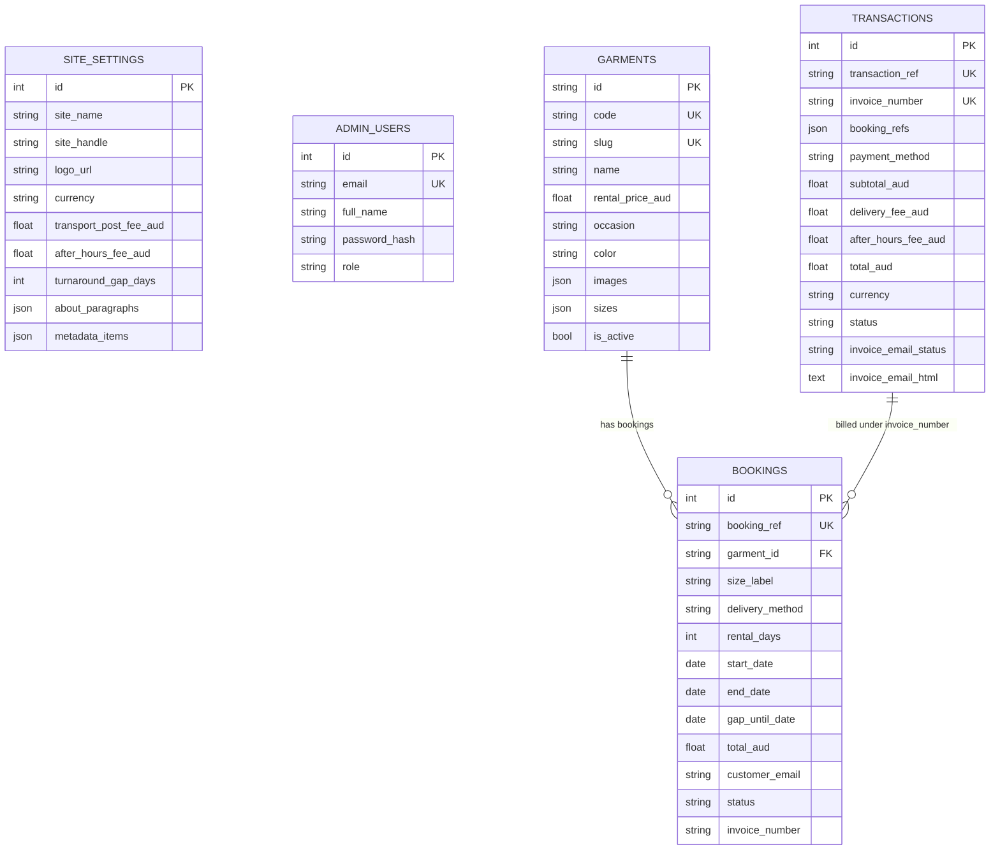

# PostgreSQL Schema & Business Rules

Tài liệu mô tả cấu trúc cơ sở dữ liệu **PostgreSQL** (`stoe`) và các luật nghiệp vụ cốt lõi được thực thi trong tầng Backend.

---

## 1. Sơ đồ quan hệ dữ liệu (ERD)



---

## 2. Chi tiết 5 bảng PostgreSQL (`backend/app/models.py`)

1. **`site_settings`** (Singleton `id = 1`):
   * Lưu toàn bộ thông tin web chỉnh sửa từ Admin: `site_name` (`Maison de Lua`), `site_handle` (`maisondelua`), `logo_url` (`/images/image.png`), `currency` (`AUD`), Hero, About, Spotlight, 3 cột MetadataBar, thông tin studio/mạng xã hội/ngân hàng/PayID và các tham số phí/nghiệp vụ (`transport_post_fee_aud`, `after_hours_fee_aud`, `turnaround_gap_days`, `business_open_time`, `business_close_time`).
2. **`admin_users`**:
   * Lưu tài khoản quản trị với mật khẩu băm `PBKDF2-HMAC-SHA256` (120,000 vòng + salt ngẫu nhiên 16 bytes).
3. **`garments`**:
   * Danh mục áo dài độc bản với giá cơ sở gói 4 ngày (`rental_price_aud`), mảng `images` JSON và mảng `sizes` JSON (`label`, `bust`, `waist`, `hip`, `length`, `available`).
4. **`bookings`**:
   * Lưu từng lịch đặt thuê gồm mã áo, size, `delivery_method` (`pick_in_person` | `transport_post`), `rental_days` (`1 | 2 | 4 | 8`), `start_date`, `end_date`, `gap_until_date`, khung giờ, snapshot giá AUD, thông tin khách guest, địa chỉ giao hàng và trạng thái (`pending`, `confirmed`, `active`, `returned`, `cancelled`).
5. **`transactions`**:
   * Lưu giao dịch thanh toán AUD, mã hóa đơn `invoice_number`, phương thức thanh toán (`card`, `bank_transfer`, `studio_pay`), `card_last4`, breakdown tiền AUD, trạng thái thanh toán (`paid`, `pending`, `refunded`, `failed`) và bản lưu `invoice_email_html` + `invoice_email_status`.

---

## 3. Luật nghiệp vụ cốt lõi (`backend/app/services/booking_rules.py`)

### 3.1 Hình thức giao nhận (`Post`) & Gói thời gian (`Choose time`)
| Hình thức | Mã hệ thống | Phí mặc định (AUD) | Gói ngày hợp lệ |
| :--- | :--- | :---: | :--- |
| **Pick in Person** | `pick_in_person` | `$0.00 AUD` | `1`, `2`, `4`, `8` ngày |
| **Transport Post** | `transport_post` | `$16.95 AUD` | **Chỉ `4` và `8` ngày** (`1`, `2` ngày bị từ chối) |

### 3.2 Hệ số giá AUD & Ngày trả (`end_date`)
Dựa trên giá cơ sở 4 ngày `rental_price_aud`:
* `1 ngày`: hệ số `0.45x` — trả trong ngày (`end_date = start_date`)
* `2 ngày`: hệ số `0.70x` — `end_date = start_date + 1 ngày`
* `4 ngày`: hệ số `1.00x` — `end_date = start_date + 3 ngày` (**Khóa ngày bắt đầu vào Thứ 2, Thứ 3, Thứ 4** — chỉ mở Thứ 5 đến Chủ Nhật)
* `8 ngày`: hệ số `1.75x` — `end_date = start_date + 7 ngày`

### 3.3 Ràng buộc giãn cách 1 ngày cùng loại áo
Với hai booking không bị hủy `[start_a, end_a]` và `[start_b, end_b]` trên **cùng một `garment_id`** và khoảng đệm `gap_days = site_settings.turnaround_gap_days` (mặc định `1`):
```python
conflict = (start_a <= end_b + timedelta(days=gap_days)) and (end_a >= start_b - timedelta(days=gap_days))
```
* **Ý nghĩa**: Giữa 2 lượt thuê cùng chiếc áo luôn có tối thiểu **1 ngày trọn vẹn** cho quy trình kiểm tra, giặt hấp sinh học và khử khuẩn.
* **Ví dụ**: Áo `AD-12` có booking ngày `2027-01-01` → ngày `2026-12-31` (trước) và `2027-01-02` (sau) là ngày gap; khách tiếp theo chỉ được đặt bắt đầu từ `2027-01-03` trở đi.
* Áp dụng đồng thời với các booking đã lưu trong PostgreSQL **và** giữa nhiều mục nằm trong cùng một giỏ hàng khi Guest Checkout.

### 3.4 Phụ phí trả sau giờ làm việc (After-Hours)
* Chỉ áp dụng cho `pick_in_person` khi `return_time > business_close_time` (mặc định sau `09:00 PM`): cộng thêm `after_hours_fee_aud` (mặc định `+$20.00 AUD`).
* Với gói `1 ngày` nhận tại studio, `return_time` bắt buộc lớn hơn `pickup_time`.

### 3.5 Dịch vụ hóa đơn Email (`backend/app/services/email_service.py`)
* Tự động sinh hóa đơn HTML tiếng Anh định dạng tiền tệ AUD có tên thương hiệu, mã hóa đơn, chi tiết từng áo/lịch hẹn và hướng dẫn PayID/BSB (nếu chọn chuyển khoản).
* Nếu biến môi trường `SMTP_HOST` được cấu hình trong `.env`: gửi email thật qua SMTP STARTTLS (`invoice_email_status = "sent"`).
* Nếu `SMTP_HOST` để trống (môi trường local dev): ghi log và lưu toàn bộ HTML hóa đơn trong bảng `transactions` (`invoice_email_status = "simulated_sent"`) để xem trực tiếp trên trang xác nhận checkout và Admin Console.

---

## Lịch sử thay đổi

| Version | Ngày | Người sửa | Agent | Mô tả thay đổi |
| :--- | :--- | :--- | :--- | :--- |
| 1.0.0 | 2026-11-22 | notworLe | Antigravity | Khởi tạo tài liệu schema PostgreSQL 5 bảng và đặc tả luật nghiệp vụ Backend |
