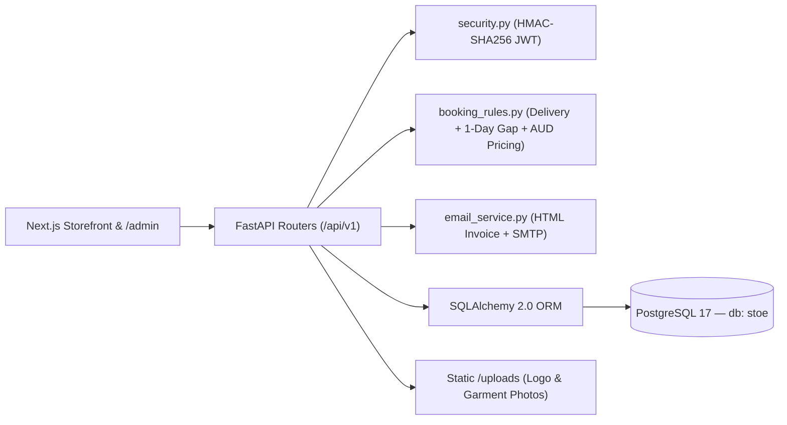

# Backend Documentation — Maison de Lua (`maisondelua`)

Tài liệu kỹ thuật đầy đủ cho dịch vụ Backend API (**FastAPI + SQLAlchemy 2.0 + PostgreSQL 17**) phục vụ nền tảng cho thuê Áo Dài **Maison de Lua** (Melbourne, Australia — 100% English, đơn vị **AUD**).

---

## 1. Mục lục tài liệu (`backend/docs/`)

| Tài liệu | Vai trò | Nội dung chính |
| :--- | :--- | :--- |
| [`API_REFERENCE.md`](API_REFERENCE.md) | **API Spec** | Danh sách toàn bộ endpoint Public Storefront, Admin Auth, Admin Console, request/response và mã lỗi |
| [`DATABASE_AND_RULES.md`](DATABASE_AND_RULES.md) | **Schema & Business Logic** | Sơ đồ ERD PostgreSQL (5 bảng), luật `Pick in Person` vs `Transport Post`, giãn cách 1 ngày cùng áo, công thức tính giá AUD và dịch vụ hóa đơn Email |
| [`TEST_REPORT.md`](TEST_REPORT.md) | **QA / Test Report** | Kết quả kiểm thử tự động (`ruff`, `pytest`) và E2E thực tế kết nối PostgreSQL local |
| [`../../docs/DEPLOY_RENDER_SUPABASE.md`](../../docs/DEPLOY_RENDER_SUPABASE.md) | **Production Deploy** | Hướng dẫn triển khai Docker Backend trên Render + Frontend trên Vercel + PostgreSQL & Storage trên Supabase |

---

## 2. Kiến trúc thư mục `backend/`

```text
backend/
├── main.py                       # FastAPI app factory, CORS, StaticFiles (/uploads), lifespan DB create + seed
├── pyproject.toml                # Dependencies (fastapi, uvicorn, sqlalchemy, psycopg, python-dotenv, ruff, pytest)
├── Dockerfile                    # Container Python 3.12-slim (tùy chọn khi dùng Docker)
├── docs/                         # Tài liệu Backend (Thư mục này)
├── uploads/                      # Ảnh upload từ Admin Console (logo, ảnh áo dài — gitignored)
├── app/
│   ├── config.py                 # Đọc .env tự động (load_dotenv): DATABASE_URL, ADMIN_*, SMTP_*, CORS_ORIGINS
│   ├── database.py               # SQLAlchemy Engine, SessionLocal, Base, get_db()
│   ├── models.py                 # 5 bảng ORM: site_settings, admin_users, garments, bookings, transactions
│   ├── schemas.py                # Pydantic v2 request/response schemas + validators
│   ├── security.py               # PBKDF2-SHA256 password hash + HMAC-SHA256 Bearer JWT + get_current_admin
│   ├── seed.py                   # Seed idempotent: Maison de Lua, /images/image.png, 12 áo dài AUD, 3 booking mẫu
│   ├── routers/
│   │   ├── public.py             # Storefront API: site-settings, garments, availability, check, guest checkout, invoice
│   │   ├── auth.py               # Admin login & profile (/api/v1/auth/login, /me)
│   │   └── admin.py              # Admin CRUD: overview, site-settings, upload, garments, bookings, transactions
│   └── services/
│       ├── booking_rules.py      # Luật giao nhận, gói 1/2/4/8 ngày, giãn cách 1 ngày cùng áo, tính giá AUD
│       └── email_service.py      # Render HTML Tax Invoice AUD + gửi SMTP hoặc lưu bản preview simulated_sent
└── test/
    ├── connection_test.py        # Smoke test cơ bản
    └── test_api.py               # Bộ test end-to-end 7 nhóm kịch bản phủ toàn bộ nghiệp vụ & Admin API
```

---

## 3. Sơ đồ luồng xử lý Backend



---

## 4. Khởi chạy Local không dùng Docker (Windows PowerShell)

```powershell
# 1. Cài đặt môi trường & kiểm tra/tạo database 'stoe' trên PostgreSQL global
.\runs\setup.ps1

# 2. Chạy riêng Backend API (Port 8000, tự reload)
.\runs\backend.ps1

# 3. Hoặc chạy cả Backend + Frontend cùng lúc
.\runs\start-app.ps1
```

* API Health: `http://localhost:8000/health`
* Swagger UI: `http://localhost:8000/docs`
* Tài khoản Admin mặc định (tạo tự động khi startup nếu chưa có): `admin@maisondelua.com.au` / `admin123` (đổi qua `ADMIN_EMAIL` / `ADMIN_PASSWORD` trong `.env`).

---

## Lịch sử thay đổi

| Version | Ngày | Người sửa | Agent | Mô tả thay đổi |
| :--- | :--- | :--- | :--- | :--- |
| 1.0.0 | 2026-11-22 | notworLe | Antigravity | Khởi tạo tài liệu tổng quan Backend Maison de Lua (FastAPI + PostgreSQL) |
