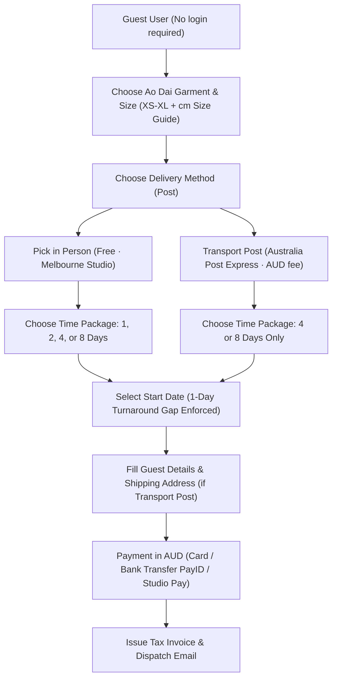

# Business Requirements — Maison de Lua

Comprehensive business specification for **Maison de Lua** (`maisondelua`), an editorial Vietnamese Ao Dai rental platform operating in **Melbourne, Australia**.

* **Storefront & Admin Language**: 100% English.
* **Currency**: Exclusively Australian Dollars (**AUD**).
* **Brand Logo**: `/images/image.png` (editable via Admin Console).
* **Database & Stack**: PostgreSQL 17 · FastAPI (Python) · Next.js 16 + Tailwind CSS v4.

---

## 1. Customer (Guest) Booking Flow

### 1.1 Delivery Methods & Rental Packages

| Delivery Method | API Code | Default Fee (AUD) | Eligible Rental Packages |
| :--- | :--- | :---: | :--- |
| **Pick in Person** | `pick_in_person` | `$0.00 AUD` (Free) | **All packages**: `1`, `2`, `4`, `8` days |
| **Transport Post** | `transport_post` | `$16.95 AUD` (configurable) | **`4` and `8` days only** (`1` and `2` days disabled/rejected) |

### 1.2 Package Pricing Multipliers (Base = 4-Day Rate in AUD)

| Package | Days | Multiplier | Return Date Rule |
| :--- | :---: | :---: | :--- |
| 1-Day Event | `1` | `0.45x` | Same calendar day (`start_date`) |
| 2-Day Weekend | `2` | `0.70x` | `start_date + 1 day` |
| 4-Day Standard | `4` | `1.00x` | `start_date + 3 days` (**Monday, Tuesday & Wednesday start dates locked**; Thu–Sun only) |
| 8-Day Extended | `8` | `1.75x` | `start_date + 7 days` |

### 1.3 Mandatory 1-Day Same-Garment Turnaround Gap
* Every physical Ao Dai requires a **1-day eco-steaming, inspection, and UV sanitization gap** (`turnaround_gap_days = 1`, editable in Admin) between any two non-cancelled bookings of the **same garment**.
* Conflict rule for two bookings `[s1, e1]` and `[s2, e2]` on the same `garment_id`:
  `s1 <= e2 + 1 day` AND `e1 >= s2 - 1 day` → **Conflict (HTTP 409)**.
* Example: If Garment `AD-12` is booked on `2027-01-01` (1 day), `2027-01-02` is blocked as the 1-day turnaround gap; the next booking can start on `2027-01-03`. Different garments may be booked on the same day.

### 1.4 Studio Hours & After-Hours Surcharge (Pick in Person)
* Standard studio hours: `08:00 AM` – `09:00 PM`.
* For 1-day `Pick in Person`, Return Time must be strictly after Pickup Time.
* Returns after `09:00 PM` (`09:30 PM`, `10:00 PM`, `11:00 PM`) display an after-hours notice and apply a configurable surcharge (`+$20.00 AUD`).

### 1.5 Guest Checkout & Invoice Email
* Guests complete booking without signing in: Contact info (+ Australian shipping address when using `Transport Post`) → AUD Payment (`card`, `bank_transfer`, or `studio_pay` for Pick in Person) → Tax Invoice generated (`INV-MDL-...`) and emailed via SMTP (or persisted as HTML invoice preview when SMTP is not configured).

---

## 2. Admin Console Use Cases (`/admin`)

Protected by Admin login (`POST /api/v1/auth/login`), default seeded account `admin@maisondelua.com.au` / `admin123`:

1. **Edit Website Information (`PUT /api/v1/admin/site-settings`)**:
   * Brand name (`Maison de Lua`), handle (`maisondelua`), tagline, logo URL + media upload (`POST /api/v1/admin/upload`).
   * Hero, About, Spotlight, and Pre-Footer MetadataBar copy & images.
   * Studio address, contact email/phone, social links, Australian bank/PayID details.
   * Live AUD fee rules: Transport Post fee, After-Hours fee, Turnaround Gap days, business hours.
2. **Manage Ao Dai Catalog (`CRUD /api/v1/admin/garments`)**:
   * Add, edit, upload garment photos, configure AUD 4-day base price, sizes/measurements (cm) & availability, archive or delete garments.
3. **Manage Bookings (`GET/PATCH /api/v1/admin/bookings`)**:
   * Filter by status (`pending`, `confirmed`, `active`, `returned`, `cancelled`), inspect customer details, delivery method, dates & 1-day gap, and update booking status.
4. **View Transactions & Invoices (`GET/PATCH/POST /api/v1/admin/transactions`)**:
   * View paid/pending/refunded AUD revenue, reconcile bank transfers, preview exact emailed HTML invoice, and resend invoice emails.

---

## Change History

| Version | Date | Author | Agent | Summary |
| :--- | :--- | :--- | :--- | :--- |
| 2.0.0 | 2026-11-22 | notworLe | Antigravity | Updated to Maison de Lua fullstack spec: English-only, AUD currency, Pick in Person vs Transport Post package rules, 1-day garment gap, guest checkout + email invoice, and Admin Console |
| 1.0.0 | 2026-11-10 | notworLe | Antigravity | Initial Ao Dai rental booking specification |
