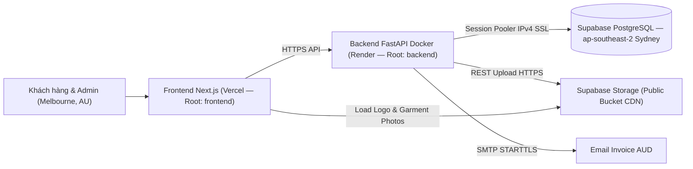

# Hướng Dẫn Deploy Production: Render (Docker Backend) + Vercel (Frontend) + Supabase

Kiến trúc chuẩn cho **Maison de Lua** (`maisondelua`, Melbourne — AUD):
* **Frontend (Next.js 16)**: **Vercel** (`Root Directory: frontend`)
* **Backend (FastAPI)**: **Render Web Service** chạy **Docker** ([`backend/Dockerfile`](../backend/Dockerfile) + [`render.yaml`](../render.yaml))
* **Database & Media**: **Supabase** — PostgreSQL (Session Pooler IPv4) + Supabase Storage Public Bucket (CDN)
* **Biến Production cục bộ**: lưu trong `.env.production` *(đã được `.gitignore` chặn tuyệt đối, không bao giờ đẩy lên Git; dùng để copy/import vào Render & Vercel)*.

---

## Kiến trúc Production

---

## Bước 1: Thiết lập Supabase (Database + Storage)

1. Tạo Project trên [Supabase](https://supabase.com), chọn region **Sydney (`ap-southeast-2`)**.
2. **Database URL (cho Render IPv4)**:
   * Vào **Connect → Connection String → Method: Session pooler** (cổng `5432`).
   * Copy chuỗi `postgresql://postgres.<ref>:<pass>@aws-0-ap-southeast-2.pooler.supabase.com:5432/postgres?sslmode=require` (Backend tự chuẩn hóa `postgresql://` → `postgresql+psycopg://`).
3. **Storage Bucket cho ảnh Admin upload**:
   * Vào **Storage → New bucket**: đặt tên `maison-de-lua-media` (hoặc tên khác rồi khai báo vào `SUPABASE_STORAGE_BUCKET`), bật **Public bucket = ON**.
4. Lấy `SUPABASE_URL` và `SUPABASE_SERVICE_ROLE_KEY` tại **Project Settings → API** *(chỉ đặt ở Render Backend, tuyệt đối không đưa lên Vercel Frontend)*.

---

## Bước 2: Deploy Backend Docker lên Render

Dự án có sẵn [`render.yaml`](../render.yaml) khai báo duy nhất service Docker `maison-de-lua-backend` (`rootDir: backend`, `dockerfilePath: ./Dockerfile`, `healthCheckPath: /health`).

1. Đẩy code lên GitHub (`git push origin main`).
2. Vào [Render Dashboard](https://dashboard.render.com) → **New → Blueprint** (hoặc **New → Web Service → Docker** với Root Directory = `backend`).
3. Copy các biến Backend từ file `.env.production` của bạn vào **Render → Environment** *(Render hỗ trợ nút "Add from .env" — chỉ paste các biến Backend bên dưới)*:

| Biến trên Render (Backend) | Ghi chú |
| :--- | :--- |
| `DATABASE_URL` | Chuỗi **Session pooler** của Supabase (`?sslmode=require`) |
| `CORS_ORIGINS` | Domain Vercel của bạn, vd: `https://maisondelua.vercel.app` (nhiều domain cách nhau bằng dấu phẩy, không có `/` cuối) |
| `ADMIN_EMAIL` | Email đăng nhập `/admin` |
| `ADMIN_PASSWORD` | Mật khẩu đăng nhập `/admin` |
| `JWT_SECRET` | Chuỗi bí mật ≥ 32 ký tự |
| `SUPABASE_URL` | `https://<project-ref>.supabase.co` |
| `SUPABASE_SERVICE_ROLE_KEY` | Secret `service_role` key từ Supabase |
| `SUPABASE_STORAGE_BUCKET` | `maison-de-lua-media` *(hoặc tên bucket bạn đã tạo)* |
| `SMTP_HOST`, `SMTP_PORT`, `SMTP_USER`, `SMTP_PASSWORD`, `SMTP_FROM` | *(Tùy chọn)* SMTP gửi hóa đơn email AUD thật |

4. Chờ Docker build xong và kiểm tra `https://<render-backend-url>/health` → `{"status": "healthy"}`.

---

## Bước 3: Deploy Frontend lên Vercel

1. Vào [Vercel Dashboard](https://vercel.com) → **Add New → Project** → chọn repo `Stoe`.
2. **Root Directory**: chọn **`frontend`** *(quan trọng!)*.
3. Framework Preset: **Next.js** (Vercel tự nhận diện `next.config.ts` và `postcss.config.mjs`).
4. **Environment Variables** trên Vercel (chỉ cần đúng 2 biến sau từ `.env.production`, **KHÔNG** paste `DATABASE_URL` hay `SUPABASE_SERVICE_ROLE_KEY` lên Vercel!):

| Biến trên Vercel (Frontend) | Giá trị |
| :--- | :--- |
| `NEXT_PUBLIC_API_URL` | `https://<render-backend-url>` *(không có `/` cuối)* |
| `INTERNAL_API_URL` | `https://<render-backend-url>` *(không có `/` cuối)* |

5. Bấm **Deploy**. Sau khi Vercel cấp domain thật (vd `https://maisondelua.vercel.app`), nhớ quay lại **Render → `CORS_ORIGINS`** cập nhật khớp chính xác domain Vercel đó (và redeploy nếu cần).

---

## Bước 4: Kiểm tra bảo mật & nghiệm thu Production

* [ ] `.env.production` nằm trong `.gitignore` (không bao giờ commit lên Git).
* [ ] Không có biến `SUPABASE_SERVICE_ROLE_KEY`, `DATABASE_URL`, `JWT_SECRET` nào bị khai báo trên Vercel.
* [ ] `GET https://<render-backend-url>/api/v1/site-settings` trả về `Maison de Lua` và `AUD`.
* [ ] Mở `https://<vercel-domain>/admin` → đăng nhập → thử upload 1 ảnh mới → kiểm tra URL trả về trỏ tới `https://<project-ref>.supabase.co/storage/v1/object/public/...`.

---

## Lịch sử thay đổi

| Version | Ngày | Người sửa | Agent | Mô tả thay đổi |
| :--- | :--- | :--- | :--- | :--- |
| 1.1.0 | 2026-11-22 | notworLe | Antigravity | Chốt kiến trúc Render (Docker Backend only) + Vercel (Frontend) + Supabase và hướng dẫn dùng `.env.production` |
| 1.0.0 | 2026-11-22 | notworLe | Antigravity | Khởi tạo hướng dẫn deploy Render + Supabase |
