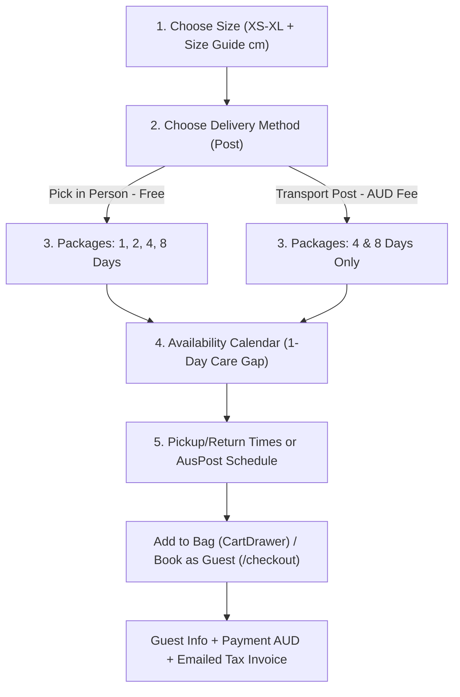

# Frontend Features, Routes & User Flows

Mô tả chi tiết kiến trúc giao diện, bản đồ route, state management và các luồng tương tác của **Maison de Lua** (`frontend/src/`).

---

## 1. Bản đồ Routes (`frontend/src/app/`)

| Route | Component chính | Vai trò |
| :--- | :--- | :--- |
| `/` | `Hero`, `About`, `Spotlight`, `MetadataBar` | Trang chủ Editorial — 100% nội dung (tên web, logo, ảnh, câu quote, 3 cột metadata) đọc động từ `SiteSettingsContext` |
| `/product` | `CollectionView`, `CollectionFilters`, `CollectionGrid`, `ProductCard` | Bộ sưu tập Áo Dài (The Archive) — gọi live `GET /api/v1/garments`, lọc theo Dịp mặc / Size / Màu sắc / Giá AUD, phân trang Load More |
| `/product/[slug]` | `ProductDetailClient`, `ProductGallery`, `ProductBookingInteractive` | Chi tiết áo dài & Booking Engine (bọc `<Suspense>` chuẩn Next.js 16 PPR) |
| `/size-guide` | `SizeGuidePage` | Hướng dẫn quy trình thuê 4 bước, so sánh `Pick in Person` vs `Transport Post` và bảng số đo cm chuẩn |
| `/checkout` | `CheckoutPage` | Thanh toán Guest Checkout (điền thông tin, địa chỉ Úc cho Transport Post, chọn phương thức thanh toán AUD) & màn hình hóa đơn + xem trước HTML email |
| `/admin` | `AdminPage` + 4 tab trong `components/admin/` | Cổng quản trị Studio độc lập (ẩn Header/Footer khách hàng qua `StorefrontShell`) |

---

## 2. State Management & Kết nối Backend

1. **`SiteSettingsContext`** (`src/context/SiteSettingsContext.tsx`):
   * Gọi `GET /api/v1/site-settings` khi mount; có `DEFAULT_SITE_SETTINGS` dự phòng khi build tĩnh/offline.
   * Khi Admin lưu cấu hình mới ở `/admin`, `setSettingsLocally()` đồng bộ ngay lập tức toàn bộ Header, Footer, MobileMenu, Hero, About, Spotlight, MetadataBar và biểu phí AUD.
2. **`CartContext`** (`src/context/CartContext.tsx`):
   * Dùng `useSyncExternalStore` + `localStorage` (`maisondelua_cart_v2`), tránh Hydration Mismatch và lỗi cascading renders của React 19.
   * Tính tổng hoàn toàn bằng **AUD**: `subtotalAud`, `deliveryTotalAud`, `afterHoursTotalAud`, `grandTotalAud`.
3. **API Client** (`src/lib/api.ts`):
   * Kết nối tới `NEXT_PUBLIC_API_URL` (mặc định `http://localhost:8000`), tự ánh xạ `snake_case` ↔ `camelCase` cho toàn bộ Public và Admin endpoints.
4. **`StorefrontShell`** (`src/components/layout/StorefrontShell.tsx`):
   * Hiển thị `Header`, `Footer`, `CartDrawer` trên các route khách hàng và ẩn chrome này trên `/admin` để Admin Console có giao diện sidebar riêng.

---

## 3. Luồng Khách hàng (Guest Booking Engine)

* **Đồng bộ lịch trực tiếp**: `ProductBookingInteractive.tsx` gọi `GET /api/v1/garments/{id}/availability` và hợp nhất với các item cùng áo đã có trong `CartContext`.
* **Chuyển đổi thông minh**: Nếu khách đang chọn gói `1` hoặc `2` ngày (Pick in Person) rồi chuyển sang `Transport Post`, hệ thống tự nâng lên gói `4 Days` và hiện thông báo giải thích.
* **Trực quan hóa giãn cách 1 ngày & Khóa Thứ 2–3–4 gói 4 ngày**: Trên lịch tháng hiển thị rõ các trạng thái `Selected`, `Booked`, `1-Day Care Gap` và **`Mon–Wed Locked (4d)`** (khi chọn gói 4 ngày, toàn bộ ô Thứ 2, Thứ 3, Thứ 4 tự động khóa bấm và hiện nhãn `Lock`). Nếu dải ngày chọn chạm vào booking, ngày gap hoặc Thứ 2–4 của gói 4 ngày, nút `ADD TO BAG` và `BOOK & CHECKOUT AS GUEST` tự động khóa kèm cảnh báo chi tiết.

---

## 4. Giao diện Admin Console (`/admin`)

Bảo vệ bằng màn hình đăng nhập Admin (`POST /api/v1/auth/login`, lưu token trong `localStorage` và xác thực qua `GET /api/v1/auth/me`).

| Tab | Component | Tính năng quản trị |
| :--- | :--- | :--- |
| **Overview** | `src/app/admin/page.tsx` | 4 thẻ KPI AUD (Paid Revenue, Active Bookings, Archive Garments, Invoices Issued) + 5 booking & 5 giao dịch gần nhất |
| **Website Info** | `AdminSettingsTab.tsx` | Đổi tên web (`Maison de Lua`), handle (`maisondelua`), upload/đổi logo (preview trực tiếp), sửa Hero/About/Spotlight/MetadataBar, liên hệ/Bank/PayID, phí Transport Post / After-Hours AUD và số ngày giãn cách |
| **Ao Dai Catalog** | `AdminGarmentsTab.tsx` | Tìm kiếm, bảng danh sách áo dài, modal Thêm/Sửa đầy đủ (mã áo, tên, slug, giá 4 ngày AUD, dịp mặc, màu, upload nhiều ảnh, bảng chỉnh sửa số đo & trạng thái còn hàng từng size), Xóa/Archive an toàn |
| **Bookings** | `AdminBookingsTab.tsx` | Lọc theo trạng thái (`all`, `pending`, `confirmed`, `active`, `returned`, `cancelled`), tìm kiếm, cập nhật trạng thái trực tiếp trên bảng, modal xem chi tiết lịch giao/nhận + ngày giãn cách 1 ngày + địa chỉ giao hàng |
| **Transactions** | `AdminTransactionsTab.tsx` | Thanh tổng hợp doanh thu Paid / Pending / Refunded AUD, lọc & tìm kiếm, đổi trạng thái thanh toán, modal xem trước HTML hóa đơn (`iframe srcDoc`) và nút **Resend Email** |

---

## Lịch sử thay đổi

| Version | Ngày | Người sửa | Agent | Mô tả thay đổi |
| :--- | :--- | :--- | :--- | :--- |
| 1.0.0 | 2026-11-22 | notworLe | Antigravity | Khởi tạo tài liệu kiến trúc tính năng, routes và luồng Storefront + Admin Console |
