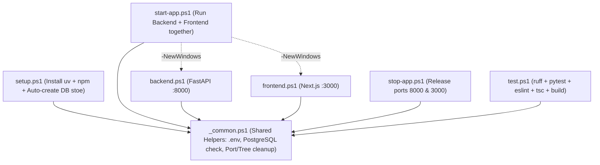

# Runs Module (`runs/`) — Local Runner Scripts

Thư mục `runs/` chứa bộ script điều phối cục bộ cho **Maison de Lua** trên **Windows PowerShell** (không cần Docker), dùng trực tiếp **PostgreSQL service cài global**, **FastAPI (`backend/.venv`)**, và **Next.js (`frontend/node_modules`)**.

---

## 1. Sơ đồ kiến trúc module `runs/`



---

## 2. Danh sách & Mô tả từng script

| File | Môi trường | Tham số hỗ trợ | Chức năng chính |
| :--- | :---: | :--- | :--- |
| [`_common.ps1`](_common.ps1) | PS 5.1 / 7 | *(Được dot-source)* | Module dùng chung: xác định đường dẫn repo, nạp biến môi trường từ `.env` (`Import-RepoEnv`), kiểm tra & tự tạo database PostgreSQL nếu chưa có (`Test-PostgresReachable -AutoCreateDb`), tìm & tắt cây tiến trình theo port (`Get-ListeningPidsOnPort`, `Stop-ProcessTree`, `Stop-PortProcesses`) |
| [`setup.ps1`](setup.ps1) | PS 5.1 / 7 | `-ForceNpm` | Cài đặt ban đầu không cần Docker: tạo `.env` từ `.env.example` nếu thiếu, chạy `uv sync --directory backend --dev`, chạy `npm ci` nếu thiếu `frontend/node_modules`, và kiểm tra kết nối (tự tạo database `stoe` trên PostgreSQL local nếu chưa có) |
| [`start-app.ps1`](start-app.ps1) | PS 5.1 / 7 | `-BackendPort 8000`<br>`-FrontendPort 3000`<br>`-NewWindows`<br>`-Restart`<br>`-Turbopack` | Script khởi động chính cho cả **Backend + Frontend**: kiểm tra port trống (hoặc tự dọn với `-Restart`), kiểm tra PostgreSQL, ghi log vào `logs/backend.log` & `logs/frontend.log`, in log có màu `[BACKEND]`/`[FRONTEND]`, và **tự động tắt sạch cả 2 cây tiến trình khi nhấn `Ctrl+C`** |
| [`backend.ps1`](backend.ps1) | PS 5.1 / 7 | `-Port 8000`<br>`-NoReload` | Chạy riêng FastAPI Backend (`uvicorn main:app --reload`) với `.env` đã nạp sẵn |
| [`frontend.ps1`](frontend.ps1) | PS 5.1 / 7 | `-Port 3000`<br>`-Turbopack` | Chạy riêng Next.js Frontend (mặc định `--webpack` kết hợp `@tailwindcss/postcss` để ổn định trên Windows; truyền `-Turbopack` nếu muốn bật Turbopack) |
| [`stop-app.ps1`](stop-app.ps1) | PS 5.1 / 7 | `-BackendPort 8000`<br>`-FrontendPort 3000` | Dừng triệt để mọi tiến trình đang giữ port `8000` và `3000` (tránh tiến trình mồ côi theo quy tắc dự án R-09 / D-023) |
| [`test.ps1`](test.ps1) | PS 5.1 / 7 | — | Chạy đủ 5 bước kiểm thử tự động: `ruff check` → `pytest` → `eslint` → `tsc --noEmit` → `next build --webpack` |
| [`start-app.sh`](start-app.sh) | Bash (Linux/WSL) | `BACKEND_PORT`, `FRONTEND_PORT` | Script legacy cho môi trường Unix/Git Bash |

---

## 3. Luồng lệnh sử dụng nhanh (Windows PowerShell)

Chạy từ thư mục gốc dự án (`D:\notworLe\Desktop\gitvanhub\Stoe`):

```powershell
# Bước 1: Cài dependencies & kiểm tra/tạo DB PostgreSQL local
.\runs\setup.ps1

# Bước 2: Khởi động Backend (:8000) + Frontend (:3000) trong cùng 1 cửa sổ
.\runs\start-app.ps1

# (Tùy chọn) Mở 2 cửa sổ PowerShell riêng biệt:
.\runs\start-app.ps1 -NewWindows

# (Tùy chọn) Tự giải phóng port 8000/3000 cũ rồi khởi động lại:
.\runs\start-app.ps1 -Restart

# Bước 3: Tắt sạch toàn bộ server khi xong việc:
.\runs\stop-app.ps1

# Kiểm thử toàn bộ Backend + Frontend trước khi commit:
.\runs\test.ps1
```

---

## 4. Lưu ý kỹ thuật cho Windows PowerShell 5.1

* **Thuần ASCII**: Toàn bộ file `runs/*.ps1` giữ chuẩn ký tự ASCII (không dùng dấu gạch ngang dài Unicode hay ngoặc kép cong) để tương thích 100% cả Windows PowerShell 5.1 lẫn PowerShell 7.
* **ExecutionPolicy**: Nếu Windows chặn chạy script `.ps1`, dùng:
  ```powershell
  powershell -ExecutionPolicy Bypass -File .\runs\start-app.ps1
  ```
* **Biến môi trường `.env`**: Mọi script tự động đọc file [`.env`](../.env.example) ở thư mục gốc (`DATABASE_URL`, `ADMIN_EMAIL`, `ADMIN_PASSWORD`, `SMTP_*`, `NEXT_PUBLIC_API_URL`). Không commit `.env` lên Git.
* **Logs**: Khi chạy `start-app.ps1` ở chế độ mặc định, log realtime được lưu tại `logs/backend.log`, `logs/backend.err.log`, `logs/frontend.log`, `logs/frontend.err.log`.

---

## Lịch sử thay đổi

| Version | Ngày | Người sửa | Agent | Mô tả thay đổi |
| :--- | :--- | :--- | :--- | :--- |
| 1.0.0 | 2026-11-22 | notworLe | Antigravity | Khởi tạo tài liệu mô tả module `runs/` cho bộ script chạy local bằng Windows PowerShell |
